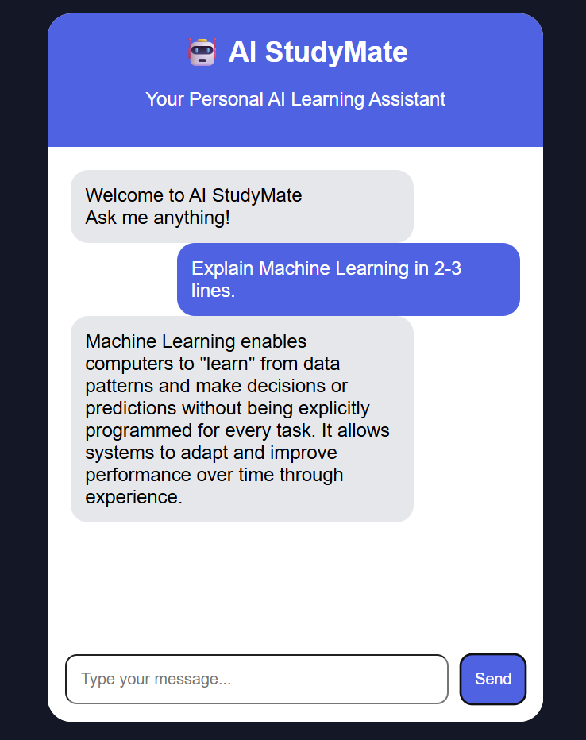

# AI StudyMate

AI StudyMate is a simple AI-powered learning chatbot built using Flask and the Google Gemini API. It allows users to ask study-related questions and receive AI-generated responses through an easy-to-use web interface.

## Features

- Ask questions and get AI-generated answers
- Integrated with Google Gemini API
- Clean and responsive user interface
- Secure API key management using `.env`
- Built with Flask for the backend

## Tech Stack

- Python
- Flask
- HTML
- CSS
- JavaScript
- Google Gemini API

## Project Demo



## Project Structure

```
AI-StudyMate-Chatbot
│── app.py
│── requirements.txt
│── .env.example
│── .gitignore
│
├── static
│   ├── style.css
│   └── script.js
│
└── templates
    └── index.html
```

## How to Run

Clone the repository:

```bash
git clone https://github.com/Aarushi1004/AI-StudyMate-Chatbot.git
```

Go to the project folder:

```bash
cd AI-StudyMate-Chatbot
```

Install the required packages:

```bash
pip install -r requirements.txt
```

Create a `.env` file and add your Gemini API key:

```env
GOOGLE_API_KEY=your_api_key_here
```

Run the application:

```bash
python app.py
```

Open your browser and visit:

```
http://127.0.0.1:5000
```

## Future Improvements

- Save chat history
- User login and authentication
- Support multiple AI models
- Improve UI and mobile responsiveness